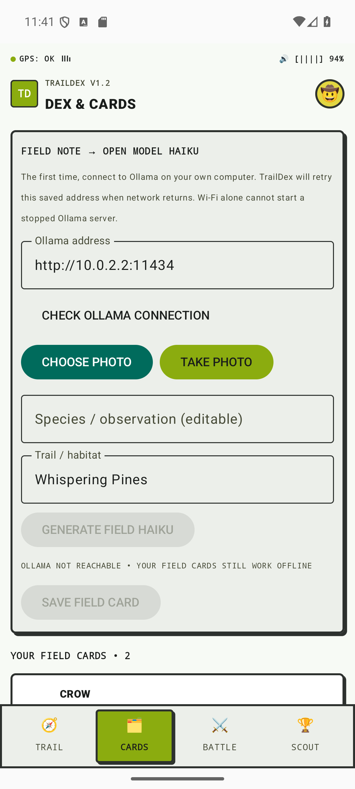
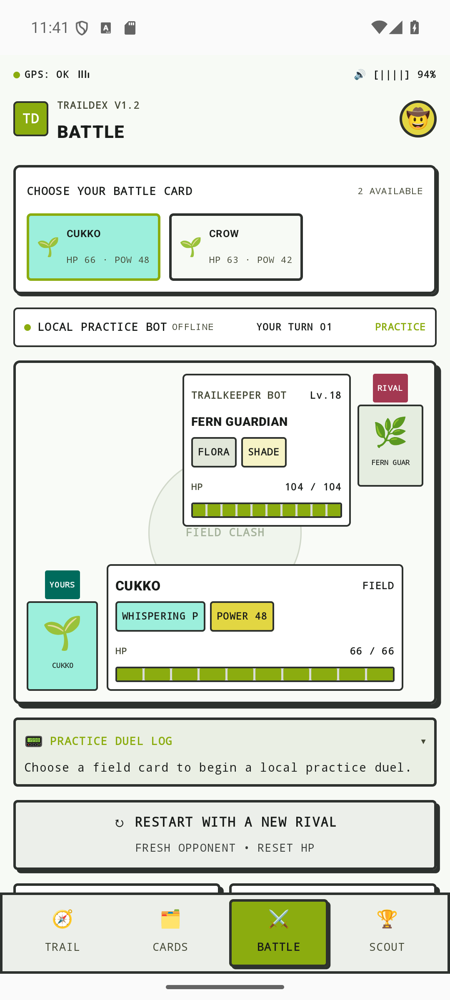
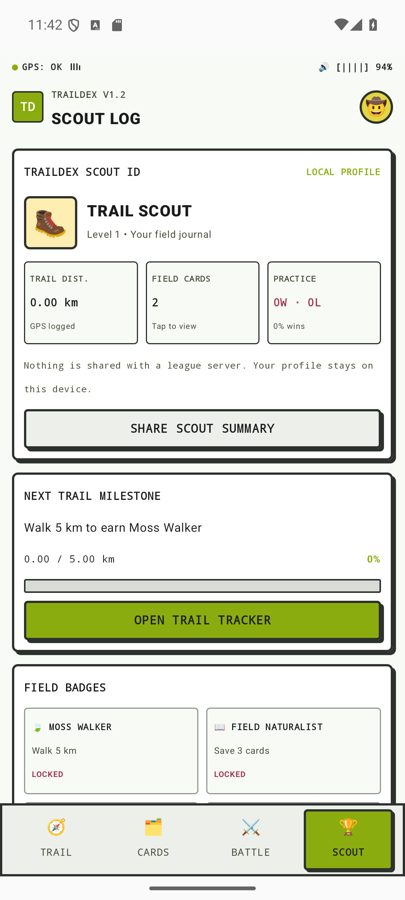

# TrailDex

TrailDex is an open-source Android field guide game: record your own GPS walk on a live map, collect a nature observation as a retro card with a haiku, and try that card in an offline practice battle.

**Outdoor exploration · on-device collection · optional open-weight AI · retro nature cards**

## Screenshots







## Try TrailDex on your Android phone

The quickest way to try TrailDex is to download the APK directly from this repository. You do not need Android Studio, a cable, or a computer.

1. On your Android phone, tap [Download TrailDex for Android](https://raw.githubusercontent.com/sudeepsarmah/traildex/main/downloads/traildex-debug.apk). The APK is about 12 MiB.
2. If prompted, confirm the download. Wait for it to finish.
3. Open the downloaded APK from your browser's download notification, or open **Files → Downloads → traildex-debug.apk**.
4. If Android asks, allow your browser or Files app to **Install unknown apps**. This permission is only needed to install this APK; you can turn it off again afterward.
5. Return to the installer and tap **Install**, then **Open**.
6. Open **Trail** and grant location permission while using the app. For a first walk, enable phone location and go outdoors until GPS gets a fix.
7. On **Trail**, tap **Pick Start** and **Pick Finish**, then tap those points on the map and choose **Find Walking Route**. TrailDex draws the walk route on the map and shows an estimated distance and time. This needs internet.
8. Tap **Start a Walk**, name it, and follow your route outdoors. **Finish & Save Walk** stores the GPS trace, distance, and time on your phone; saved walks can be selected to review their path later.
9. Open **Cards**, enter something you observed, choose a habitat, and generate/save a card. This works without Ollama or internet using one of the bundled fallback verses.
10. Open **Battle**, select a saved card, and try a local practice battle. Different rivals have different stats; the match ends with a simple win/loss animation.

TrailDex is a community demo distributed as a debug APK. Android displays an install warning because it was downloaded outside Google Play. Only install it if you trust this repository. Updates are not automatic: return to this README and download the current APK again when the project is updated. See the [step-by-step tester tutorial](docs/TESTING.md) for Ollama setup, permissions, sharing, and troubleshooting.

## Build from source

To build the app yourself, install Android Studio, Android SDK 36, and JDK 17. Clone this repository and open the `traildex` folder in Android Studio:

   ```sh
   git clone https://github.com/sudeepsarmah/traildex.git
   cd traildex
   ```

Open the cloned folder in Android Studio, let Gradle sync, and run the `app` configuration on an emulator or connected Android phone. Grant location permission when starting a walk.

From PowerShell, with an Android device or emulator already running:

```powershell
.\gradlew.bat installDebug
```

To build an APK without installing it:

```powershell
.\gradlew.bat :app:assembleDebug
```

The APK is written to `app/build/outputs/apk/debug/app-debug.apk`.

For GPS permissions, map planning, saved route logs, offline fallback verses, practice battles, and troubleshooting, see [the tester tutorial](docs/TESTING.md). A three-step tour appears when the app first opens. Suggested repository description and topics are in [GitHub About copy](docs/GITHUB_ABOUT.md).

The Hacktoberfest Week 1 submission draft is in [docs/HACKTOBERFEST_ARTICLE.md](docs/HACKTOBERFEST_ARTICLE.md); it includes screenshots and the Android download link.

## Optional open-weight AI

AI photo suggestions and model-written haiku use a user-run [Ollama](https://ollama.com/) server. Install Ollama on a computer reachable from the phone, then run:

```sh
ollama pull gemma3:4b
ollama serve
```

For an Android emulator, the default host address is `http://10.0.2.2:11434`. On a physical phone, Ollama must listen on the computer's LAN interface: configure `OLLAMA_HOST=0.0.0.0:11434`, restart Ollama, and use `http://<computer-LAN-IP>:11434` in **Cards → Ollama address**. Allow the port only on a trusted private network; never expose Ollama directly to the public internet. See the [tester tutorial](docs/TESTING.md) for the Windows setup steps.

TrailDex saves the configured Ollama address and checks it when Cards opens; it retries when network connectivity returns. This only reconnects to a running, reachable Ollama host. Turning on internet does not start a model server or make a computer on another network reachable. If Ollama or internet is unavailable, card creation still works and the app supplies one of several varied offline verses. AI suggestions can be wrong; review them before saving. The model and generated images are not bundled with this demo.

## What works offline

- Saved cards, field journal, local practice battles, and GPS walk-distance tracking.
- A set of varied fallback haiku; they are templates, not generated by a model.
- GPS tracking and saved route traces; displaying live map tiles and requesting an in-app walking route require internet.

TrailDex uses the open-source [Leaflet](https://leafletjs.com/) map library, public OpenStreetMap raster tiles, and the [FOSSGIS OSRM foot router](https://routing.openstreetmap.de/about.html) to draw walking routes in the app. No Google Maps or Mapbox SDK, API key, or billing account is used. The public map and routing services are best-effort community infrastructure: use them lightly, expect occasional downtime, and verify routes before walking. Public OSM tiles are not an offline map download service. Attribution is visible on the map; see the [OSM tile policy](https://operations.osmfoundation.org/policies/tiles/) and [FOSSGIS routing usage notes](https://routing.openstreetmap.de/about.html).

## Scope and privacy

There is no account system or online battle service. Cards and recorded GPS route traces stay in app storage. A photo and observation are sent only to the Ollama address configured by the user when they request AI generation. Viewing the map requests tiles from OpenStreetMap; requesting a walking route sends the selected start and finish to FOSSGIS. These services can receive the requester's IP address and route coordinates. The app does not provide turn-by-turn navigation, background auto-capture, or verified species identification.

TrailDex is an open-source demo under the [MIT License](LICENSE).

## Why open-weight AI

TrailDex can send a user-selected nature photo and observation prompt to an Ollama server the user controls, instead of requiring a hosted AI account. That makes it possible to keep these inputs on a trusted local computer and to inspect or change the model setup in the open app code. The current demo defaults to Gemma 3 4B through Ollama; model inference is optional, requires a separately installed model and reachable host, and is not available from the phone alone. When it is unavailable, the app uses bundled verse templates and manual observation entry. That fallback keeps the outdoor collection flow usable, but it is not AI output.

## Current demo limits

- TrailDex shows live OSM map tiles, GPS traces, and saved walks. Walking route geometry comes from the public FOSSGIS OSRM foot service and is drawn in-app. Both public services are best-effort and subject to fair-use rules; this demo is not turn-by-turn navigation.
- Photo identification and model-written haiku require a user-managed Ollama server. Network return triggers a retry of the saved endpoint, but does not launch/deploy Ollama. Offline haiku are varied templates. AI identifications are suggestions, not verified species records.
- No online accounts or multiplayer battles are included. Cards, journal entries, and walk totals are stored locally on the device.
- This is a community demo, not an emergency navigation or ecological-identification tool.

Bug reports and contributions are welcome through [GitHub Issues](https://github.com/sudeepsarmah/traildex/issues).
